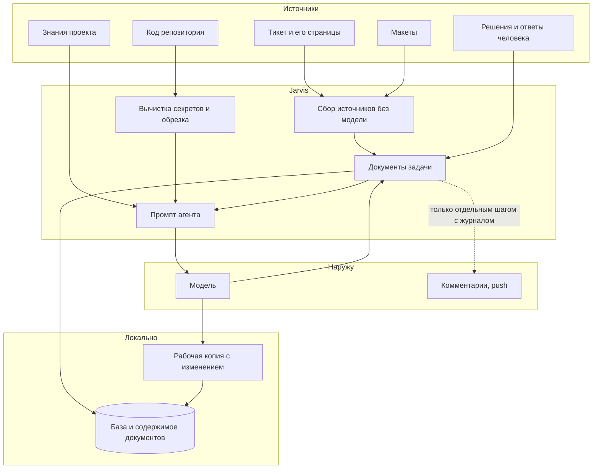
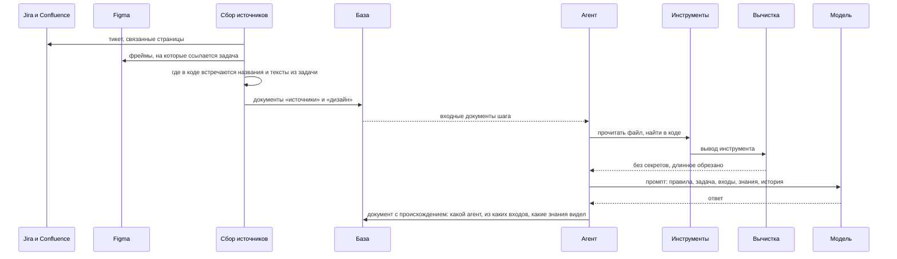

# Поток данных

Откуда Jarvis берёт данные, что с ними делает по дороге, где хранит и что уходит с машины.

## Общая картина



## По шагам



## Что на входе

| Откуда | Что | Как попадает |
|---|---|---|
| Тикет | описание, ссылки, связанные задачи | через MCP-сервер, один раз в начале задачи; агенты дочитывают только то, чего там нет |
| Страницы | требования из Confluence, включая встроенные ссылки на макеты | так же |
| Макеты | тексты, раскладка, компоненты фреймов Figma | так же, с кэшем на сутки |
| Код | файлы, поиск, история git, граф зависимостей | инструменты агента, по запросу |
| Знания | стандарты, скиллы, документы, глоссарий | пакет в каждом промпте и чтение по запросу |
| Человек | утверждения, комментарии, ответы, заметки | обязательные правила в промпте следующих шагов |

Источники задачи собираются кодом, без модели, до первого агента. Так их не читают заново на каждом шаге, а
агент получает уже найденные места в коде.

## Что по дороге

- **Секреты.** Каждый вывод инструмента проходит через вычистку до того, как попадёт к модели, в документ или в
  лог. Ищутся ключи, токены, пароли в присваиваниях, строки с высокой энтропией, значения заданных переменных
  окружения. Одинаковый секрет внутри задачи заменяется одинаковой меткой, так что модель может понять, что это
  одно и то же, но не узнает значение.
- **Запрещённые файлы.** `.env`, ключи, `secrets/` и всё, что вы добавите в список, агент не прочитает вообще:
  отказ приходит до чтения.
- **Длинный вывод.** Агент получает начало и ссылку, полный текст остаётся в хранилище и читается по запросу.
- **Окно модели.** Когда история агента разрастается, старые результаты инструментов сначала обрезаются, потом
  сворачиваются в краткую сводку. Оригиналы остаются в хранилище.

## Что хранится

Всё лежит у вас на диске.

```
~/.jarvis/
  config.yaml          модели, роли, квоты, личные MCP-серверы
  jarvis.db            задачи, шаги, документы, решения, события, расход токенов, индекс знаний, граф кода
  artifacts/blobs/     содержимое документов и длинных выводов, по хешу
  worktrees/           рабочие копии задач
  logs/                технический журнал по дням, тоже без секретов
  cache/               ответы MCP, пробы моделей, кэш зависимостей

<проект>/.jarvis/      настройки и знания команды, в git
```

Документ задачи никогда не перезаписывается. Правка — новая версия: кто её сделал (агент, человек, инструмент), из
каких входов и с какими знаниями. Поэтому `jarvis explain src/file.ts:42` может ответить, откуда взялась строка:
задача, спецификация, источники, вызовы.

## Что уходит с машины

Только две вещи:

1. **Вызовы моделей.** Политика данных проекта решает, к каким моделям можно обращаться. Конфиденциальный проект
   работает только с моделями внутри контура, и роутер не пропустит вызов к облачной до того, как он случится.
2. **Действия во внешних системах.** Комментарий в тикете, push, pull request. Агенты не могут сделать это сами.
   Действие выполняет отдельный шаг через журнал: намерение записывается до вызова, результат — после, а после
   падения Jarvis проверяет на сервере, было ли действие, вместо того чтобы повторить его вслепую.

Телеметрия наружу не отправляется.
