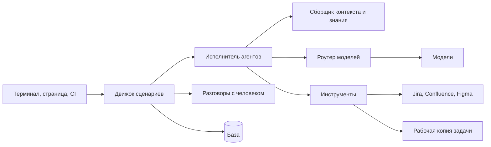
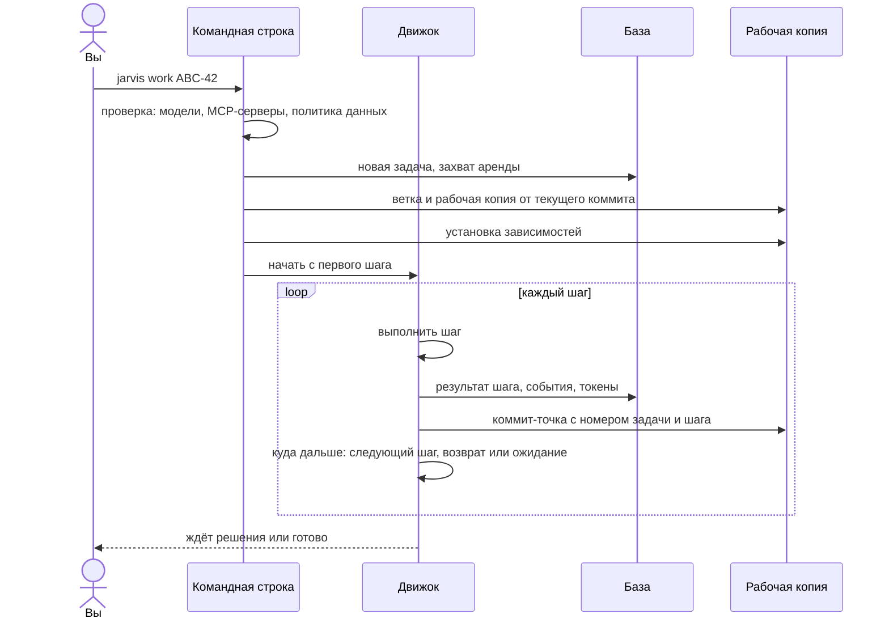
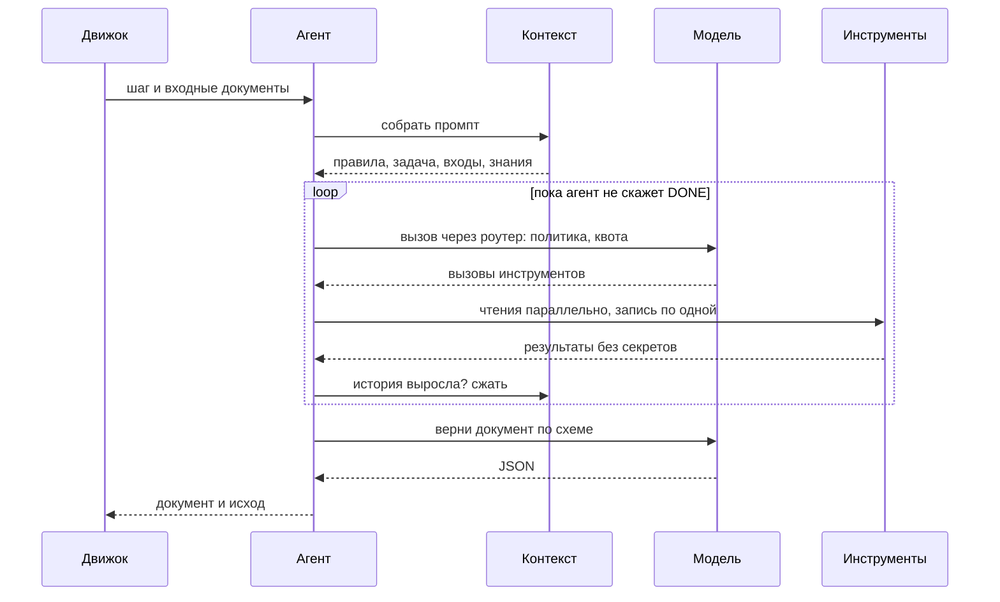
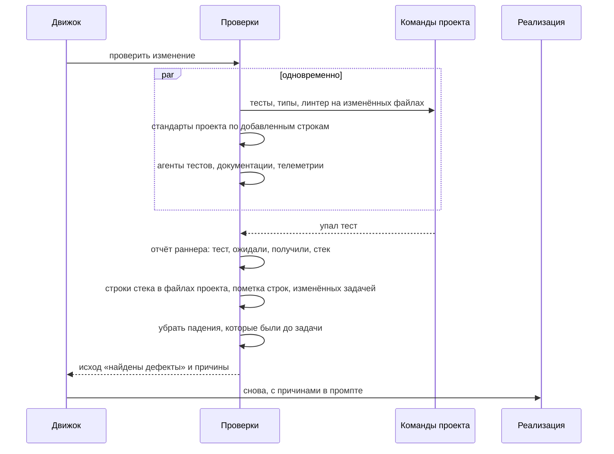
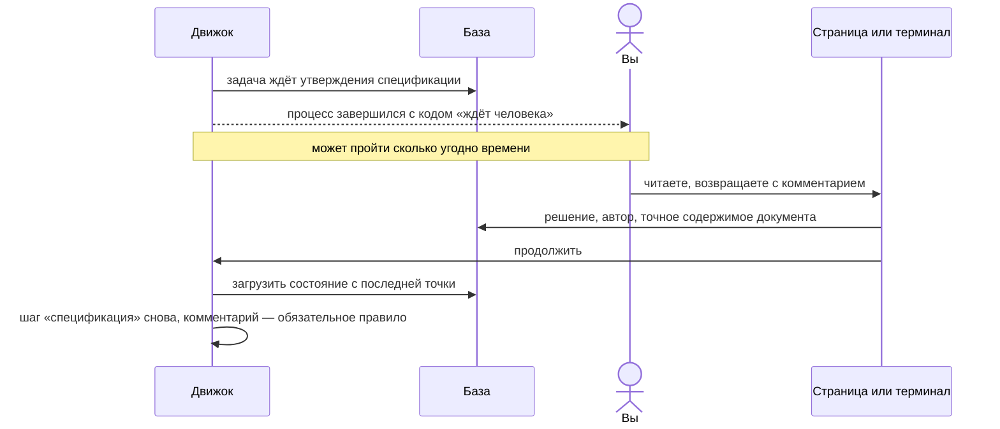

# Архитектура

Jarvis — один процесс на Node.js, который запускается на машине разработчика или в CI. Внешних оркестраторов,
очередей и серверов у него нет: состояние лежит в локальной базе SQLite, код задачи — в отдельной рабочей копии
git. Каждая задача исполняется своим процессом, поэтому несколько задач идут параллельно и не мешают друг другу.

## Из чего состоит

| Часть | Что делает |
|---|---|
| Движок сценариев | ведёт задачу по шагам из YAML, решает, куда идти после каждого шага, сохраняет состояние на каждой границе |
| Исполнитель агентов | ведёт разговор агента с моделью: промпт, вызовы инструментов, итоговый документ |
| Сборщик контекста | собирает промпт из слоёв и следит, чтобы он помещался в окно модели |
| Знания | выбирает навыки, стандарты и документы под задачу, ищет по базе знаний, строит граф кода |
| Роутер моделей | выбирает модель под роль агента, проверяет политику данных и квоту, переключает на запасную |
| Инструменты | чтение и запись файлов, поиск, команды проекта, MCP-серверы; перед каждым вызовом — проверка прав, после — вычистка секретов |
| Разговоры с человеком | утверждения, вопросы агентов, замечания ревью: каждое — тред с состоянием |
| Адаптеры языков | что знает Jarvis о конкретном стеке: граф кода, разбор отчётов тестов. Ядро о стеках не знает ничего |

## Запуск задачи

Аренда нужна, чтобы задачу никогда не исполняли два процесса сразу. Процесс продлевает её, пока жив. Если он
умер, задачу можно забрать: `jarvis resume --steal`.

## Один шаг агента

Исход агента выбирается из списка, который объявлен заранее. Движок по нему выбирает следующий шаг: ревью с
исходом «надо исправить» вернёт задачу в реализацию, а если возвратов было слишком много — остановит и спросит
человека.

## Проверки и возврат

## Утверждение и продолжение

Процесс не висит, пока ждёт человека: он завершается, а состояние остаётся в базе. Продолжить можно из терминала,
со страницы, из CI или фоновым процессом.

## Принципы

- **Состояние только в базе.** Всё, что нужно для продолжения, сохраняется на границе шага. Падение процесса
  стоит максимум текущего шага.
- **Наименьшие права.** У каждого агента свой список инструментов. Модель видит только разрешённые.
- **Внешние действия ровно один раз.** Комментарий в Jira или push сначала записывается как намерение, потом
  выполняется, потом отмечается. После падения Jarvis проверит на сервере, было ли действие, прежде чем повторять.
- **Ядро не знает о стеках.** Всё про конкретный язык — в адаптерах. Тест архитектуры не даёт ядру упомянуть
  конкретный фреймворк.
- **Документы неизменяемы.** Каждая правка — новая версия с указанием, кто её сделал и из чего. Утверждение
  привязано к версии.

Дальше: [поток данных](./data) и [надёжность и безопасность](./safety).
