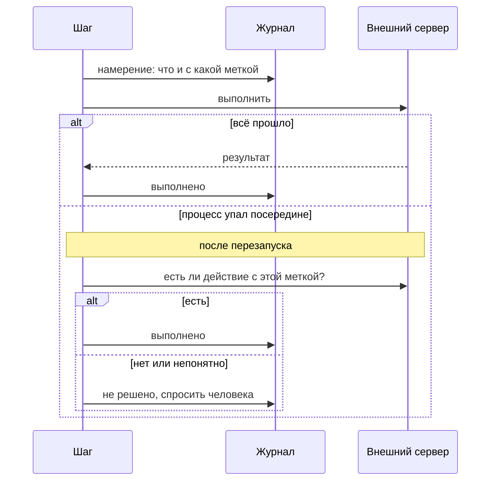

# Надёжность и безопасность

Jarvis рассчитан на закрытый контур: код не должен уйти туда, куда его не пускают, секреты не должны попасть в
модель или в лог, внешнее действие не должно выполниться дважды, а работа не должна пропасть из-за упавшего
процесса.

## Задача переживает всё

Состояние задачи сохраняется на каждой границе шага: где она, сколько раз прошла каждый возврат, история агента
каждые несколько вызовов, коммит в рабочей копии. Поэтому:

- закрытый терминал или Ctrl-C — задача стоит на месте и продолжается одной командой;
- кончилась квота — пауза до освобождения окна, потом продолжение без вашего участия;
- модель недоступна — задача ждёт и периодически проверяет, не вернулась ли она;
- упал процесс — следующий запуск подхватит задачу с последней точки.

Задачу всегда исполняет один процесс. Он держит аренду и продлевает её. Процесс с устаревшей арендой не может ничего
записать, так что два процесса не испортят одну задачу, даже если запустить их одновременно.

## Код не уходит, куда нельзя

У проекта есть класс данных, у каждой модели — где она находится, у каждого внешнего сервера — в какой он сети.
Роутер сверяет это до вызова. Конфиденциальный проект не может обратиться к облачной модели или к серверу в
интернете, даже если агент очень попросит.

Если какой-то сервер нужен вопреки правилу — например, макеты в облачной Figma, — его можно разрешить в настройках
проекта явно, с причиной и только на чтение. Каждый запуск об этом исключении напоминает.

## Секреты не доходят до модели

- В конфигурации нет секретов, только ссылки на связку ключей или переменные окружения.
- Файлы вроде `.env`, ключей и `secrets/` агенту недоступны вообще.
- Всё, что выводят инструменты и команды, проходит вычистку до того, как попадёт к модели, в документ или в лог.

## Права агентов

Каждый агент получает только нужные ему инструменты. Исследователь и автор спецификации только читают. Агент тестов
пишет только в файлы тестов. Реализация может писать код и запускать команды проекта, но не может действовать во
внешних системах. Произвольная команда оболочки по умолчанию выключена.

Перед каждым вызовом инструмента проверяется:

1. есть ли инструмент в списке агента;
2. не запрещён ли он настройками или профилем (например, в CI);
3. можно ли в эту сеть с этим классом данных;
4. можно ли писать в эту рабочую копию.

Отказ окончательный: агент видит причину, и правила запрещают ему пробовать то же другими аргументами. Модель с
самого начала видит только разрешённые инструменты.

## Внешние действия ровно один раз

Комментарий в Jira, смена статуса, pull request, push проходят через журнал:

Если проверить нельзя, решение остаётся за человеком: повторять действие или нет.

## Рабочая копия

Каждая задача работает в своей ветке и своей рабочей копии от коммита, с которого начала. Ваш каталог не меняется,
пока вы не выполните `jarvis apply`: изменения задачи придут одним коммитом. Старые копии убирает `jarvis gc`.

## Всё записано

В базе есть каждый шаг, каждая версия документа с происхождением, каждое решение с автором и точным содержимым,
каждое внешнее действие, вопрос, событие и расход токенов. `jarvis export` переносит задачу целиком на другую
машину, например из CI к разработчику.
