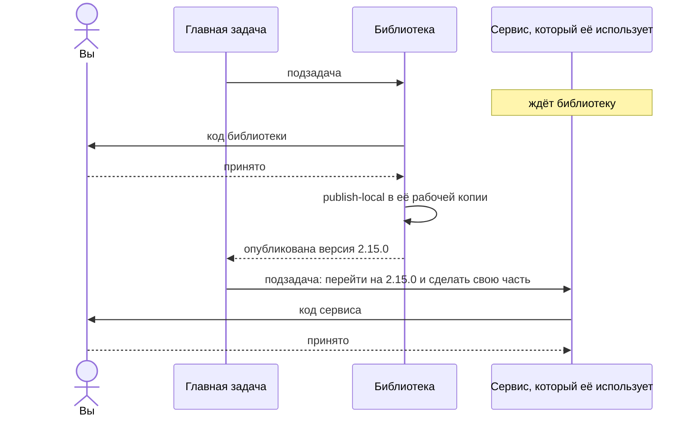
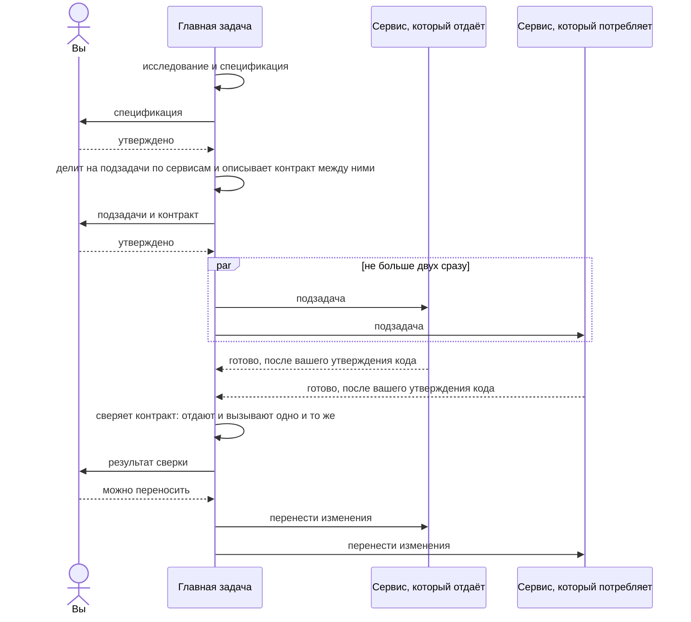

# Много сервисов

Если продукт — это несколько сервисов в разных репозиториях, держать `.jarvis/` в каждом неудобно, а иногда
нельзя: в репозиториях сервисов не должно быть ничего лишнего. Тогда всё, что нужно Jarvis, живёт в отдельном
репозитории знаний рядом с сервисами.

```
repos/
  jarvis-knowledge/          репозиторий знаний
    project.yaml             общие настройки и карта сервисов
    knowledge/
      glossary.md            глоссарий общий для всех
      landscape.md           общие документы: границы, кто за что отвечает
      services/
        orders-api/          знания одного сервиса
        payments-service/
    standards/  skills/  workflows/  agents/
  orders-api/                код сервиса, без .jarvis
  payments-service/
  web-portal/
```

## Как завести

```sh
mkdir jarvis-knowledge && cd jarvis-knowledge
jarvis init --knowledge
```

Команда создаст репозиторий, положит заготовки и черновик карты: по строке на каждый git-репозиторий рядом. Карту
дальше правите сами — убрать лишнее, дописать сервис, папка которого называется иначе.

```sh
jarvis onboard                       # пройдёт по всем сервисам карты
jarvis onboard --service orders-api  # или по одному
```

`onboard` посмотрит на каждый сервис и запишет в карту, бэкенд это или фронтенд и какими командами его проверять.
Уже заданное не трогает. Если репозиторий сервиса лежит не рядом, путь к нему задаётся в личном
`~/.jarvis/config.yaml`.

```yaml
# jarvis-knowledge/project.yaml
version: 1
services:
  orders-api:
    kind: backend
    tools:
      local: { tests: ./gradlew test, typecheck: ./gradlew classes -q }
  web-portal:
    kind: frontend
    tools:
      local: { tests: pnpm test, lint: pnpm lint }
```

Новый сервис — новая строка в `services:`, потом `jarvis onboard --service <имя>`. `jarvis init --knowledge`, запущенный
снова, ничего не перезаписывает и покажет репозитории, которых ещё нет в карте.

## Как Jarvis понимает, где он

Запущенный в репозитории сервиса без `.jarvis`, Jarvis ищет репозиторий знаний рядом (или там, куда указывает
личный конфиг) и находит в карте сервис, чей это репозиторий. Дальше всё как обычно: настройки — общие плюс
настройки сервиса, знания — общие плюс знания сервиса. Задача работает в рабочей копии сервиса, а то, что она
узнала о сервисе, пишется в репозиторий знаний.

## Общая библиотека

Бывает, что сервисы зависят от общей библиотеки, и задача меняет и её, и их. Тогда библиотеку нужно поменять
первой: сервисы должны собираться уже с её новой версией. Это отмечается в карте:

```yaml
services:
  common-lib:
    kind: library                       # меняется первой
    publishes: [com.example:common-lib] # под каким именем её подключают сервисы
    tools:
      local:
        tests: ./gradlew test
        publish-local: ./gradlew publishToMavenLocal
  orders-api:
    uses: [common-lib]                  # ждёт её, если она меняется в той же задаче
```

Руками это писать не обязательно: `jarvis onboard` сам находит библиотеки по файлам сборки и сервисы, которые их
подключают.

В задаче на несколько сервисов это работает так:



Сервисы, которые библиотеку не используют, стартуют сразу. Если публикация упала, сервисы продолжают ждать, а на
странице главной задачи видно, что вывела команда. Её можно запустить снова или запустить сервис без новой
версии, если она ему на самом деле не нужна. Порядок запуска берётся из карты, а не придумывается моделью, поэтому он
одинаковый каждый раз.

## Связи между сервисами

`onboard` записывает для каждого сервиса, какие эндпоинты он отдаёт, кого вызывает, в какие топики пишет и какие
читает. Из этого без модели собирается карта связей. Агенты сервиса получают её как документ о соседях: кто
пользуется тем, что сервис отдаёт, и чем он пользуется у других.

Если анализ влияния показывает, что часть задачи — работа другого сервиса, и карта эту связь подтверждает, задача
остановится и предложит выбор: продолжить как задачу на несколько сервисов или только в этом.

## Задача на несколько сервисов

В репозитории знаний нет кода, поэтому всё, что запускается там, работает с сервисами сразу:

- `jarvis research "…"` — исследование по нескольким сервисам: сначала карта и связи, потом агент читает знания тех
  сервисов, которых касается задача, и пишет, что нужно от каждого;
- `jarvis spec "…"` — то же до утверждённой спецификации;
- продолжение обоих (`jarvis continue` или кнопка на странице) — задача на несколько сервисов, без повторного
  исследования;
- `jarvis work` и `jarvis fix` там не запускаются: задача в одном сервисе запускается в его репозитории.

Полная задача запускается так:

```sh
jarvis work "Частичный возврат по заказу" --workflow sdd-cross
```



Главная задача сама код не пишет. Каждая подзадача — обычная задача в своём сервисе, со своей рабочей копией и
своими утверждениями. Она начинает сразу с анализа влияния: исследование и спецификация уже сделаны. Переносятся
изменения в порядке зависимостей: сначала сервис, который отдаёт, потом тот, который потребляет.

На странице `jarvis ui` во вкладке Knowledge → Services видна вся карта: что за сервисы, чем их проверяют, как они
связаны и чего не хватает.
